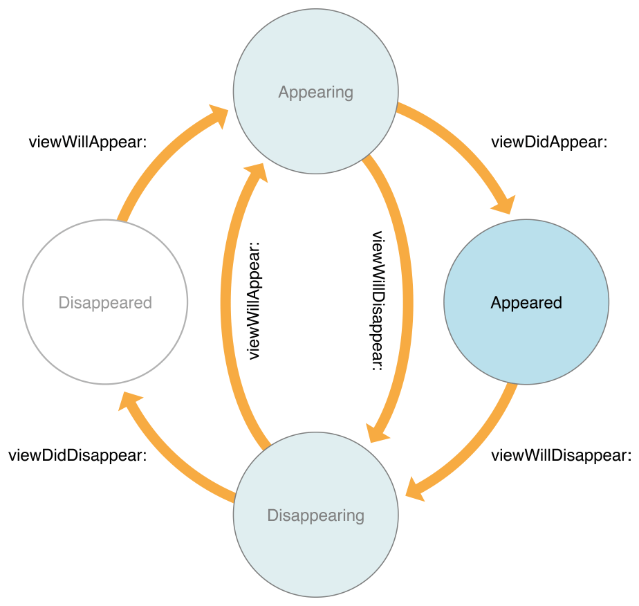

# Apuntes de teoría — videos y repaso conceptual

Notas tomadas mientras se ven los videos recomendados en `Homework.md` (temas que no son parte de un proyecto de código puntual). Formato libre por tema; lo importante es que quede el concepto, no el video.

---

## Vistas y su ciclo de vida (UIKit)



Los 4 estados (`Disappeared` → `Appearing` → `Appeared` → `Disappearing` → `Disappeared`) y los callbacks que marcan cada transición:

- `viewWillAppear:` — Disappeared → Appearing
- `viewDidAppear:` — Appearing → Appeared
- `viewWillDisappear:` — Appeared → Disappearing
- `viewDidDisappear:` — Disappearing → Disappeared

### ¿De qué está compuesta una vista (`UIView`)?

- **Frame y bounds** — dos sistemas de coordenadas: `frame` (posición/tamaño relativo al superview) vs `bounds` (posición/tamaño en el propio sistema de coordenadas de la vista, arranca en `(0,0)`).
- **Layer (`CALayer`)** — cada `UIView` tiene un `layer` de Core Animation que es lo que realmente dibuja los píxeles. Propiedades como `cornerRadius`, `borderWidth`, `shadowOpacity` viven ahí.
- **Jerarquía: `subviews` / `superview`** — árbol de vistas, con `UIWindow` como raíz. El orden en `subviews` define qué se dibuja arriba de qué.
- **Propiedades visuales** — `backgroundColor`, `alpha`, `isHidden`, `tintColor`, `transform`.
- **Constraints (AutoLayout)** — reglas de posición/tamaño relativas a otras vistas o al padre.
- **Gesture recognizers y eventos** — `UIView` hereda de `UIResponder`, participa en la cadena de respuesta a toques/gestos.

En una frase: **dónde está y cuánto mide** (frame/bounds) + **cómo se dibuja** (layer) + **con quién se relaciona** (subviews/superview) + **cómo se ve** (propiedades visuales) + **cómo reacciona** (gestos/eventos).

_(resto pendiente — completar después de ver los videos de la sección "Videos recomendados" en Homework.md)_

---

## Value types vs Reference types (Swift)

- **Value type** (`struct`, `enum`, primitivos: `Int`, `String`, `Bool`, `Array`, `Dictionary`): al asignarlo o pasarlo, se **copia**. Cada variable es independiente.
- **Reference type** (`class`): al asignarlo o pasarlo, se copia la **referencia** (puntero). Dos variables pueden apuntar al mismo objeto — mutar una afecta a la otra.

```swift
struct Punto { var x: Int }
class Caja { var valor: Int = 0 }

var p1 = Punto(x: 1)
var p2 = p1          // copia independiente
p2.x = 99            // p1.x sigue siendo 1

let c1 = Caja()
let c2 = c1          // misma instancia
c2.valor = 99        // c1.valor también es 99
```

Por qué importa en iOS: `UIView`/`UIViewController` son `class` (necesitan identidad compartida/herencia). Modelos de datos simples (`Monster`, `Drop` en dropsim) son `struct` por default — copias seguras, sin efectos secundarios inesperados. Regla práctica: **`struct` por default, `class` solo cuando se necesita identidad compartida o herencia.**

## Semantic Versioning — `MAJOR.MINOR.PATCH`

| | Significa | Cuándo subirlo |
|---|---|---|
| **MAJOR** | Cambio incompatible | Rompiste algo que ya existía |
| **MINOR** | Funcionalidad nueva, compatible | Agregaste algo sin romper lo viejo |
| **PATCH** | Corrección de bugs, compatible | Arreglaste algo sin agregar ni romper nada |

`0.x.x` = fase de prototipo (puede cambiar todo sin saltar a MAJOR todavía). Ejemplo propio: `utils.swift` (agregó funciones sin romper nada) → MINOR. Renombrar `Monster` a `Enemy` (rompe referencias existentes) → MAJOR.

## Resolución de conflictos de git

Un conflicto pasa cuando dos ramas modifican la misma línea desde bases distintas y git no puede decidir solo cuál "gana". Git marca el punto exacto en el archivo:

```
<<<<<<< HEAD
versión de la rama donde estás parado (ej. main)
=======
versión de la rama que estás mergeando
>>>>>>> nombre-de-la-rama
```

Flujo para resolverlo:
1. `git merge <rama>` falla con `CONFLICT (content): Merge conflict in <archivo>`.
2. Abrís el archivo, buscás `<<<<<<<`, decidís el contenido final (una versión, la otra, una mezcla, o algo nuevo) y borrás los marcadores.
3. `git add <archivo>` — le dice a git "ya resolví esto".
4. `git commit` — cierra el merge. El commit resultante tiene **2 padres** (se ve como un rombo `*` en `git log --graph`).
5. Si te arrepentís a mitad de camino: `git merge --abort` vuelve todo al estado previo al merge.

Cuando la ambigüedad no es técnica sino de negocio/producto (ej. dos textos de UI distintos y no está claro cuál debe quedar), la resolución correcta es consultar a quien define el requerimiento — no improvisar.

Ejercicio hecho 2026-10-01: dos ramas (`feature/ingles`, `feature/formal`) tocando la misma línea de un `print()`, mergeadas a `main` en secuencia — la segunda generó el conflicto. Resuelto manteniendo la versión en inglés.

## AutoLayout / Constraints (UIKit)

Resumen conceptual previo al video [Cómo crear vistas por código con UIKit y AutoLayout](https://www.youtube.com/watch?v=c3PZ-HZKI68) (2026-10-01) — completar con notas del video después de verlo.

- **Qué es:** relaciones matemáticas entre atributos de dos vistas (`item1.attribute1 = multiplier × item2.attribute2 + constant`), en vez de `frame` fijo. Se adapta a distinto tamaño de pantalla/rotación/Dynamic Type.
- **Atributos típicos:** `top`/`bottom`/`leading`/`trailing` (posición), `width`/`height` (tamaño), `centerX`/`centerY` (centrado).
- **API moderna — Anchors:**
  ```swift
  boton.translatesAutoresizingMaskIntoConstraints = false  // obligatorio al crear por código
  NSLayoutConstraint.activate([
      boton.topAnchor.constraint(equalTo: label.bottomAnchor, constant: 16),
      boton.leadingAnchor.constraint(equalTo: view.safeAreaLayoutGuide.leadingAnchor, constant: 20),
      boton.widthAnchor.constraint(equalToConstant: 120)
  ])
  ```
- **3 trampas comunes:**
  1. Olvidar `translatesAutoresizingMaskIntoConstraints = false` → UIKit genera constraints desde el `frame` que chocan con las tuyas.
  2. Crear una constraint sin `isActive = true` (o sin `.activate([...])`) → no hace nada.
  3. Anclar contra la vista pelada en vez de `safeAreaLayoutGuide` → queda debajo del notch/status bar/home indicator.
- **"Unable to satisfy constraints"** = el solver no tiene info suficiente para una solución única (falta tamaño y la vista no tiene *intrinsic content size*, o dos constraints se contradicen) — no es un crash de lógica de negocio.

_(pendiente: notas del video una vez visto)_

## UIScrollView — contenido que excede la pantalla

Practicado 2026-11-01 sobre el `cardsStack` horizontal de "Podrían interesarte" (Dashboard, CirujeAR). AutoLayout solo no escrolea: si el contenido mide más que la pantalla, se corta. `UIScrollView` separa dos tamaños:

- **El visor** (`frameLayoutGuide`) — lo que se ve, mismo tamaño que el scroll view. Se pinea normal al padre.
- **El contenido** (`contentLayoutGuide`) — puede medir más que el visor. No se setea `contentSize` a mano (API vieja); con AutoLayout se deduce solo de las constraints de la vista que metés adentro.

Patrón:

```swift
scrollView.translatesAutoresizingMaskIntoConstraints = false
view.addSubview(scrollView)
NSLayoutConstraint.activate([ /* pinear scrollView al padre, como cualquier vista */ ])

innerView.translatesAutoresizingMaskIntoConstraints = false
scrollView.addSubview(innerView)
NSLayoutConstraint.activate([
    innerView.topAnchor.constraint(equalTo: scrollView.contentLayoutGuide.topAnchor),
    innerView.leadingAnchor.constraint(equalTo: scrollView.contentLayoutGuide.leadingAnchor),
    innerView.trailingAnchor.constraint(equalTo: scrollView.contentLayoutGuide.trailingAnchor),
    innerView.bottomAnchor.constraint(equalTo: scrollView.contentLayoutGuide.bottomAnchor)
])
```

Con eso solo, escrolea en las dos direcciones. Para una sola dirección, se "congela" el eje que no debe crecer igualándolo al visor:
- Solo horizontal: `innerView.heightAnchor.constraint(equalTo: scrollView.frameLayoutGuide.heightAnchor)`.
- Solo vertical: `innerView.widthAnchor.constraint(equalTo: scrollView.frameLayoutGuide.widthAnchor)`.

`showsHorizontalScrollIndicator` / `showsVerticalScrollIndicator` = `false` oculta la barrita fina de scroll (cosmético, no afecta el scroll en sí).

**2 trampas nuevas, además de las 3 de la sección de AutoLayout de arriba** — ninguna de las dos las agarra el compilador, código 100% válido, solo se ven corriendo la app:

1. **Confundir quién es hijo de quién.** Un `UIView` solo puede tener un superview a la vez. Si por error metés la vista de contenido directo al stack de afuera (`sectionsStack.addArrangedSubview(cardsStack)`) en vez del scroll view (`sectionsStack.addArrangedSubview(cardsScrollView)`), y después la volvés a mover adentro del scroll view (`cardsScrollView.addSubview(cardsStack)`) — la vista de contenido queda "colgada" dentro de un scroll view que nunca entró a la jerarquía de pantalla. Resultado: nada crashea, pero la vista es invisible.
2. **`UIScrollView` no tiene *intrinsic content size*.** A diferencia de un `UILabel` (que mide lo que su texto necesita), un scroll view vacío no tiene tamaño propio — si el stack que lo contiene usa `alignment = .leading` (no estira), el scroll view colapsa a ancho/alto 0 sin una constraint explícita. Y si además una de esas constraints faltantes termina relacionando el scroll view con una vista de otra rama del árbol (la trampa #1), AutoLayout no encuentra ancestro común y **tira una excepción real — la app crashea** (`Unable to activate constraint... no common ancestor`), distinto del warning silencioso de "Unable to satisfy constraints".

## Concurrencia / GCD (Grand Central Dispatch)

Surgió armando el Worker del molde VIP de CirujeAR (Dashboard) — no es tema visto con Juan todavía.

**Qué es un hilo (thread):** una secuencia de instrucciones que se ejecutan una detrás de la otra, en orden, por un solo "trabajador". La app arranca con un solo hilo, el **hilo principal** (main thread), que es el único que puede dibujar la pantalla y responder a toques. Si ese mismo hilo se pone a hacer algo lento (leer un archivo pesado, esperar una respuesta de red), no puede dibujar mientras tanto — la app "se tilda": no está rota, está ocupada.

**Qué es GCD:** el "gerente de personal" del sistema operativo. En vez de crear/manejar hilos a mano, se empaqueta el trabajo en un bloque de código (closure) y se le entrega a una fila (`DispatchQueue`) — GCD decide qué hilo disponible lo ejecuta.

**Patrón típico — ir a background y volver a main:**

```swift
DispatchQueue.global(qos: .userInitiated).async {
    // trabajo lento (leer archivo, parsear, llamar red) — corre en background
    DispatchQueue.main.async {
        // acá sí se puede tocar UIKit (labels, tablas, alerts)
    }
}
```

- **`DispatchQueue`** — una fila de trabajo administrada por GCD.
- **`.global()`** — una fila de background compartida (no la principal).
- **`qos:`** ("quality of service") — qué tan urgente es el trabajo, para que GCD priorice. 4 niveles típicos, de más a menos urgente: `.userInteractive` (animación en vivo) → `.userInitiated` (el usuario está esperando este resultado — el caso del Worker del Dashboard) → `.utility` (tarea larga con progreso, sin apuro inmediato) → `.background` (mantenimiento invisible).
- **`.async`** — "no bloquees esperando esto, ejecutalo y avisá después" (lo opuesto, `.sync`, se queda esperando ahí parado — casi nunca se usa para este tipo de trabajo).
- **`DispatchQueue.main`** — la fila especial que siempre corre en el hilo principal. Es el único lugar permitido para tocar UIKit.

**Regla práctica (sin memorizar los 4 niveles de `qos` todavía):** background para esperar/calcular algo lento, main para cualquier cosa que termine actualizando lo que se ve en pantalla — incluido llamar a un `completion` que va a actualizar un label.


## Molde VIP del Dashboard — explicaciones que vivían como comentarios en el código

Sacadas del código de CirujeAR el 2026-11-17, cuando se limpió para dejarlo legible (commit `207e72e`). Cada bloque va con la línea de código que explicaba. Algunas mencionan "archivo N": es el orden en que se armó el molde (1 Models, 2 Worker, 3 Interactor, 4 Presenter, 5 Router, 6 CirujanoCell, 7 ObjetoCell, 8 ViewController).


### `DashboardModels.swift`

```swift
let score: Int
```

> 0 a 10 — el Presenter lo va a convertir en un color

```swift
enum Dashboard {
```

> Esto es la parte nueva de VIP. La convención (no es obligación de Swift,
> es la convención de este patrón) es armar un "caso de uso" con 3 tipos:
>
>   Request   → lo que el ViewController le pide al Interactor ("traeme el dashboard")
>   Response  → lo que el Interactor le devuelve al Presenter (datos crudos)
>   ViewModel → lo que el Presenter le devuelve al ViewController (ya formateado,
>               listo para poner en un label/celda, nada de lógica)
>
> ¿Por qué un enum "Dashboard" por afuera, y otro enum "FetchDashboard" adentro?
> Es solo una forma de AGRUPAR nombres, como ponerle apellido a algo para no
> confundirlo con el "Request" de otra pantalla.
> El enum de afuera (Dashboard) = la pantalla.
> El enum de adentro (FetchDashboard) = la acción/caso de uso dentro de esa pantalla
> (si Dashboard tuviera otra acción, ej. "marcar como favorito", sería un
> segundo enum hermano: Dashboard.MarkFavorite.Request, etc.)

```swift
}
```

> vacío a propósito: pedir el dashboard no necesita parámetros.
> si más adelante pido "dashboard de tal usuario",
> ahí le agregaría: let userId: String

```swift
let leaderboard: [Cirujano]
```

> datos tal cual vienen del Worker, sin formatear todavía

```swift
let title: String
```

> datos ya traducidos a "texto/color listo para pantalla"


### `DashboardWorker.swift`

```swift
enum DashboardWorkerError: Error {
```

> Result<Success, Failure> es un enum nativo de Swift con dos casos:
> .success(Response) o .failure(Error). Es la forma moderna de devolver
> "o salió bien, o salió mal" sin usar un Bool aparte + un optional aparte.

```swift
private struct DashboardMock: Decodable {
```

> struct privado: solo existe para que JSONDecoder tenga algo a lo que
> mapear el archivo .json completo. No lo usa nadie fuera de este archivo.

```swift
DispatchQueue.global(qos: .userInitiated).async {
```

> DispatchQueue.global = background. Esto es la parte de tus notas
> "background mientras carga el home / traes datos sin molestar al
> usuario": leer y parsear el archivo pasa en un hilo secundario,
> la pantalla no se congela mientras tanto (hoy es instantáneo
> porque es un archivo chiquito, pero el día que sea una llamada
> de red real a Supabase, esto mismo evita que la UI se trabe).
> qos quality of service

```swift
DispatchQueue.main.async { completion(.failure(DashboardWorkerError.mockFileNotFound)) }
```

> DispatchQueue.main = volver al hilo principal. SIEMPRE que
> vayas a tocar UI (o llamar algo que termine tocando UI,
> como este completion) hay que volver a .main primero.


### `DashboardWorkerProtocol.swift`

```swift
protocol DashboardWorkerProtocol {
```

> ¿Por qué un protocolo para algo que hoy tiene una sola implementación?
> Para poder reemplazar el Worker real por uno falso en un test, sin tocar
> el Interactor.

```swift
func fetchDashboard(completion: @escaping (Result<Dashboard.FetchDashboard.Response, Error>) -> Void)
```

> @escaping = el closure "completion" no se ejecuta ya mismo, se va a
> ejecutar más tarde (cuando termine de leer el archivo). Sin @escaping,
> Swift asume que el closure se usa y se descarta en el momento, y
> tira error de compilación porque lo estamos guardando para después.


### `DashboardInteractor.swift`

```swift
final class DashboardInteractor: DashboardBusinessLogic,
```

> Fijate que la clase implementa DOS protocolos a la vez, separados por coma.
> No es nada especial de VIP — en Swift una clase puede conformar a
> cuantos protocolos quiera, cada uno es "una lista de cosas que prometo
> tener". BusinessLogic = lo que el ViewController puede pedirle.
> DataStore = lo que el Router puede leerle. Son audiencias distintas.

```swift
var worker: DashboardWorkerProtocol = DashboardWorker()
```

> Tipado como el PROTOCOLO (DashboardWorkerProtocol), no como la clase
> concreta (DashboardWorker) — por la misma razón que vimos en el
> archivo 2: así, el día de mañana, puedo poner acá un Worker falso
> (para tests, o un "DashboardWorkerSupabase") sin tocar esta línea
> de más que el nombre de la clase.

```swift
worker.fetchDashboard { [weak self] result in
```

> [weak self] = "agarrá una referencia débil a self, no fuerte".
> Por qué: el closure que le paso al Worker se guarda y se llama
> DESPUÉS (recordá el @escaping del archivo 2). Si ese closure
> capturara "self" fuerte, y en algún escenario self (el Interactor)
> dejara de existir antes de que el Worker responda, el closure
> lo mantendría vivo artificialmente — eso es un "retain cycle"
> (nadie se libera cuando debería, memory leak). Con weak, si self
> ya no existe cuando llega la respuesta, simplemente no hace nada
> (por eso el "self?" con signo de pregunta en las líneas de abajo).

```swift
switch result {
```

> switch sobre un Result: Swift te obliga a manejar los dos
> casos posibles (no hay forma de "olvidarse" del failure).
> "let response" / "let error" desempaquetan el valor asociado
> a cada caso, igual que hacías con un optional en un if-let.


### `DashboardDataPassing.swift`

```swift
protocol DashboardDataPassing {
```

> Esto es nuevo: un protocolo puede exigir no solo funciones, sino también
> PROPIEDADES. "{ get }" significa "quien conforme a esto tiene que poder
> LEER una propiedad llamada dataStore" — no importa si la implementación
> es una `var` normal, una `let`, o una propiedad calculada; el protocolo
> no se mete en el cómo, solo exige que se pueda leer.


### `DashboardPresenter.swift`

```swift
weak var viewController: DashboardDisplayLogic?
```

> "weak" otra vez, pero por una razón DISTINTA a la del archivo 3.
> Ahí era un closure guardado para después; acá es una cadena de
> propiedades que se apuntan entre sí:
>   ViewController "tiene fuerte" → Interactor
>   Interactor      "tiene fuerte" → Presenter
>   Presenter       "tiene fuerte" → ViewController (si no pusiéramos weak)
> Eso cierra un círculo: A sostiene a B, B sostiene a C, C sostiene a A.
> Ninguno de los tres se libera nunca, aunque ya nadie afuera los use
> (memory leak permanente). "weak" en este último eslabón rompe el
> círculo — el ViewController sigue siendo "el dueño" de toda la cadena,
> el Presenter solo lo "conoce" sin poseerlo.

```swift
let rows = response.leaderboard.enumerated().map { index, cirujano in
```

> .map transforma un array en OTRO array, aplicando la misma
> operación a cada elemento. Acá: por cada Cirujano (datos crudos)
> devuelve un CirujanoRowViewModel (datos para pantalla). Mismo
> largo de array a la entrada y a la salida, distinto tipo.
> Es el equivalente a escribir:
>   var rows: [CirujanoRowViewModel] = []
>   for cirujano in response.leaderboard {
>       rows.append(CirujanoRowViewModel(...))
>   }
> pero sin el array vacío ni el for a mano.
> (index, cirujano) — index arranca en 0, igual que un array.
> actualmente no estan ordenados, solamente agrega la medalla por la posicion
> que ya estan ordenadas, pero esta anotado a agregar la logica del sort

```swift
viewController?.displayError(message: error.localizedDescription)
```

> localizedDescription: toda instancia de Error trae esto de regalo,
> convierte el error en un texto legible para mostrar en pantalla.

```swift
private func color(for score: Int) -> UIColor {
```

> switch con RANGOS en vez de valores puntuales. "..." es un rango
> cerrado (incluye los dos extremos). 0...3 = "0, 1, 2 o 3".
> "default" agarra todo lo que no cayó en ningún case de arriba
> (en este caso, 7 a 10) — así cubrimos los 3 tramos de FEATURES.md
> (rojo 0-3, amarillo 4-6, verde 7-10) sin tener que escribir 7...10.


### `DashboardRouter.swift`

```swift
final class DashboardRouter: NSObject, DashboardRoutingLogic, DashboardDataPassing {
```

> ¿Por qué hereda de NSObject? Es la convención de Clean Swift: el Router
> suele necesitar cosas del mundo UIKit/Objective-C para las transiciones
> entre pantallas (segues, animaciones custom) que requieren que la clase
> sea NSObject. Hoy no lo estamos usando para nada concreto, pero se deja
> así desde el molde porque sacarlo después, cuando ya haga falta, puede
> traer dolores de cabeza.

```swift
weak var viewController: DashboardViewController?
```

> Fijate la diferencia con el Presenter (archivo 4): ahí viewController
> era del tipo del PROTOCOLO (DashboardDisplayLogic). Acá es del tipo
> de la CLASE concreta (DashboardViewController). Por qué: el Router,
> cuando navegue de verdad, va a necesitar llamar métodos reales de
> UIKit (present(_:), navigationController?.pushViewController(...))
> que no están en ningún protocolo nuestro — necesita el objeto real,
> no una versión recortada de él.

```swift
weak var dataStore: DashboardDataStore?
```

> el Router lee el dataStore pero no es su dueño, el dueño es el VC
> arriba de sobra (una var siempre se puede leer, y además escribir).


### `DashboardViewController.swift`

```swift
var interactor: DashboardBusinessLogic?
```

> El Interactor tipado como protocolo (BusinessLogic) — el ViewController
> solo sabe que "le puede pedir el dashboard", no conoce al Interactor real.

```swift
var router: (NSObjectProtocol & DashboardRoutingLogic & DashboardDataPassing)?
```

> Tipo compuesto raro a primera vista: "NSObjectProtocol & DashboardRoutingLogic
> & DashboardDataPassing" significa "algo que cumple LOS TRES protocolos a la vez".
> Necesitamos los tres porque el Router (archivo 5) hereda de NSObject y
> conforma a los otros dos — esta es la forma de decir "quiero esas tres
> promesas juntas" sin referenciar la clase concreta DashboardRouter.

```swift
init() {
```

> Dos inicializadores, misma razón que viste en CirujanoCell (archivo 6):
> UIViewController también exige los dos. init() es el que se termina
> usando (SceneDelegate llama DashboardViewController() sin nib).

```swift
private func setup() {
```

> Acá se crean las 3 piezas que faltaban (Interactor, Presenter, Router)
> y se las "presenta" entre sí — cada una se guarda una referencia a la
> siguiente en la cadena. Es el único lugar de todo el molde donde se
> crean con "new"/inicializador directo; en cualquier otro lado siempre
> se habla a través de protocolos.

```swift
interactor.presenter = presenter
```

> Interactor → Presenter

```swift
presenter.viewController = self
```

> Presenter → View (weak, visto en archivo 4)

```swift
router.viewController = self
```

> Router → View (weak, visto en archivo 5)

```swift
router.dataStore = interactor
```

> Router lee del Interactor (el DataStore vacío de archivo 3)

```swift
tableView.dataSource = self
```

> "yo (self) soy quien le da los datos" — ver parte 3

```swift
tableView.delegate = self
```

> "yo (self) soy quien se entera de sus eventos" — ver parte 3

```swift
private var leaderboardRows: [CirujanoRowViewModel] = []
```

> Arrancan vacíos; se llenan cuando llega la respuesta del Presenter (abajo).

```swift
interactor?.fetchDashboard(request: Dashboard.FetchDashboard.Request())
```

> Acá arranca todo: le pido al Interactor que busque los datos.
> Esto dispara la cadena completa: Interactor → Worker → Interactor → Presenter → acá.

```swift
leaderboardTableView.reloadData()
```

> reloadData() = "repintate, tus datos cambiaron" — dispara de nuevo
> las funciones de la parte 3 para cada fila/celda visible.

```swift
func tableView(_ tableView: UITableView, numberOfRowsInSection section: Int) -> Int {
```

> UIKit pregunta esto antes de dibujar: "¿cuántas filas hay?"

```swift
func tableView(_ tableView: UITableView, cellForRowAt indexPath: IndexPath) -> UITableViewCell {
```

> UIKit pregunta esto por CADA fila visible: "dame la celda para esta posición"

```swift
let cell = tableView.dequeueReusableCell(withIdentifier: CirujanoCell.reuseID, for: indexPath) as! CirujanoCell
```

> dequeueReusableCell = pedile a la tabla una celda YA CREADA y reciclada
> (el "renderiza solo lo que se ve" de tus notas del principio) en vez
> de crear una UITableViewCell nueva cada vez.
> "as! CirujanoCell" = "esto que me devolvió es genérico (UITableViewCell),
> yo sé que en realidad es un CirujanoCell, convertímelo" — es seguro acá
> porque dos líneas arriba (en el lazy var) registramos que ESTE
> identificador siempre corresponde a CirujanoCell.


### `DashboardDisplayLogic.swift`

```swift
protocol DashboardDisplayLogic: AnyObject {
```

> Es lo que le permite al Presenter hablarle al ViewController sin conocerlo directamente
> (solo conoce "algo que sepa mostrar un Dashboard.ViewModel o un error").


### `CirujanoCell.swift`

```swift
static let reuseID = "CirujanoCell"
```

> "static" = esta constante no pertenece a NINGUNA instancia particular
> de CirujanoCell, pertenece a la CLASE en sí. Se accede como
> CirujanoCell.reuseID, sin necesitar crear una celda primero.
> La usamos para "etiquetar" el tipo de celda al registrarla y al
> reciclarla (lo vas a ver en el archivo del ViewController).

```swift
override init(style: UITableViewCell.CellStyle, reuseIdentifier: String?) {
```

> Acá aparecen DOS inicializadores, y los dos son obligatorios al
> subclasear UITableViewCell (o cualquier clase de UIKit, en realidad).
>
> 1. init(style:reuseIdentifier:) — el que se usa cuando creás la celda
>    por código (que es nuestro caso, vía register(_:forCellReuseIdentifier:)).
>
> 2. required init?(coder:) — UIKit lo exige SIEMPRE, incluso si nunca
>    vas a cargar esta celda desde un Storyboard/XIB. "required" es una
>    palabra que obliga a TODA subclase a implementarlo también (a
>    diferencia de "override", que es optativo si no cambiás nada) —
>    es la forma de UIKit de garantizar que, pase lo que pase, siempre
>    va a existir una forma de reconstruir el objeto. Como nosotros no
>    usamos Storyboards, el cuerpo queda simple: solo llama al padre.

```swift
contentView.addSubview(stack)
```

> IMPORTANTE: a una UITableViewCell no se le agregan subvistas
> directo a ella (self.addSubview), sino a su "contentView".
> La celda ya trae de fábrica una estructura interna (contentView +
> espacio para accessoryView, el ">" que a veces ves a la derecha).
> contentView es la parte "en blanco" que es nuestra para decorar;
> además es la que UIKit anima/resalta sola cuando tocás la celda.

```swift
func configure(with viewModel: CirujanoRowViewModel) {
```

> Este método NO lo exige UIKit — lo inventamos nosotros, como una
> API simple y prolija para que, cada vez que la tabla recicle esta
> celda para una fila distinta, alguien de afuera (el ViewController)
> pueda "rellenarla" con los datos nuevos en una sola llamada.


### `ObjetoCell.swift`

```swift
contentView.backgroundColor = .systemGray5
```

> backgroundColor/cornerRadius van en contentView, no en self —
> misma razón que en CirujanoCell: contentView es la parte que
> nos pertenece para decorar.

