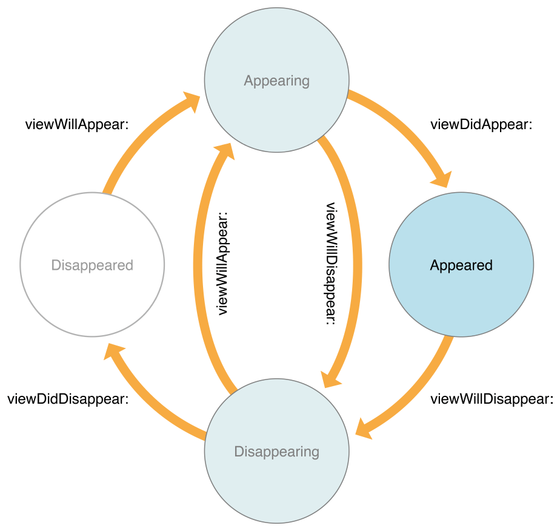

# Apuntes de teoría — videos y repaso conceptual

Notas tomadas mientras se ven los videos recomendados en `Homework.md` (temas que no son parte de un proyecto de código puntual). Formato libre por tema; lo importante es que quede el concepto, no el video.

---

## Vistas y su ciclo de vida (UIKit)



Los 4 estados (`Disappeared` → `Appearing` → `Appeared` → `Disappearing` → `Disappeared`) y los callbacks que marcan cada transición:

- `viewWillAppear:` — Disappeared → Appearing
- `viewDidAppear:` — Appearing → Appeared
- `viewWillDisappear:` — Appeared → Disappearing
- `viewDidDisappear:` — Disappearing → Disappeared

### ¿De qué está compuesta una vista (`UIView`)?

- **Frame y bounds** — dos sistemas de coordenadas: `frame` (posición/tamaño relativo al superview) vs `bounds` (posición/tamaño en el propio sistema de coordenadas de la vista, arranca en `(0,0)`).
- **Layer (`CALayer`)** — cada `UIView` tiene un `layer` de Core Animation que es lo que realmente dibuja los píxeles. Propiedades como `cornerRadius`, `borderWidth`, `shadowOpacity` viven ahí.
- **Jerarquía: `subviews` / `superview`** — árbol de vistas, con `UIWindow` como raíz. El orden en `subviews` define qué se dibuja arriba de qué.
- **Propiedades visuales** — `backgroundColor`, `alpha`, `isHidden`, `tintColor`, `transform`.
- **Constraints (AutoLayout)** — reglas de posición/tamaño relativas a otras vistas o al padre.
- **Gesture recognizers y eventos** — `UIView` hereda de `UIResponder`, participa en la cadena de respuesta a toques/gestos.

En una frase: **dónde está y cuánto mide** (frame/bounds) + **cómo se dibuja** (layer) + **con quién se relaciona** (subviews/superview) + **cómo se ve** (propiedades visuales) + **cómo reacciona** (gestos/eventos).

_(resto pendiente — completar después de ver los videos de la sección "Videos recomendados" en Homework.md)_

---

## Value types vs Reference types (Swift)

- **Value type** (`struct`, `enum`, primitivos: `Int`, `String`, `Bool`, `Array`, `Dictionary`): al asignarlo o pasarlo, se **copia**. Cada variable es independiente.
- **Reference type** (`class`): al asignarlo o pasarlo, se copia la **referencia** (puntero). Dos variables pueden apuntar al mismo objeto — mutar una afecta a la otra.

```swift
struct Punto { var x: Int }
class Caja { var valor: Int = 0 }

var p1 = Punto(x: 1)
var p2 = p1          // copia independiente
p2.x = 99            // p1.x sigue siendo 1

let c1 = Caja()
let c2 = c1          // misma instancia
c2.valor = 99        // c1.valor también es 99
```

Por qué importa en iOS: `UIView`/`UIViewController` son `class` (necesitan identidad compartida/herencia). Modelos de datos simples (`Monster`, `Drop` en dropsim) son `struct` por default — copias seguras, sin efectos secundarios inesperados. Regla práctica: **`struct` por default, `class` solo cuando se necesita identidad compartida o herencia.**

## Semantic Versioning — `MAJOR.MINOR.PATCH`

| | Significa | Cuándo subirlo |
|---|---|---|
| **MAJOR** | Cambio incompatible | Rompiste algo que ya existía |
| **MINOR** | Funcionalidad nueva, compatible | Agregaste algo sin romper lo viejo |
| **PATCH** | Corrección de bugs, compatible | Arreglaste algo sin agregar ni romper nada |

`0.x.x` = fase de prototipo (puede cambiar todo sin saltar a MAJOR todavía). Ejemplo propio: `utils.swift` (agregó funciones sin romper nada) → MINOR. Renombrar `Monster` a `Enemy` (rompe referencias existentes) → MAJOR.

## Resolución de conflictos de git

Un conflicto pasa cuando dos ramas modifican la misma línea desde bases distintas y git no puede decidir solo cuál "gana". Git marca el punto exacto en el archivo:

```
<<<<<<< HEAD
versión de la rama donde estás parado (ej. main)
=======
versión de la rama que estás mergeando
>>>>>>> nombre-de-la-rama
```

Flujo para resolverlo:
1. `git merge <rama>` falla con `CONFLICT (content): Merge conflict in <archivo>`.
2. Abrís el archivo, buscás `<<<<<<<`, decidís el contenido final (una versión, la otra, una mezcla, o algo nuevo) y borrás los marcadores.
3. `git add <archivo>` — le dice a git "ya resolví esto".
4. `git commit` — cierra el merge. El commit resultante tiene **2 padres** (se ve como un rombo `*` en `git log --graph`).
5. Si te arrepentís a mitad de camino: `git merge --abort` vuelve todo al estado previo al merge.

Cuando la ambigüedad no es técnica sino de negocio/producto (ej. dos textos de UI distintos y no está claro cuál debe quedar), la resolución correcta es consultar a quien define el requerimiento — no improvisar.

Ejercicio hecho 2026-10-01: dos ramas (`feature/ingles`, `feature/formal`) tocando la misma línea de un `print()`, mergeadas a `main` en secuencia — la segunda generó el conflicto. Resuelto manteniendo la versión en inglés.

## AutoLayout / Constraints (UIKit)

Resumen conceptual previo al video [Cómo crear vistas por código con UIKit y AutoLayout](https://www.youtube.com/watch?v=c3PZ-HZKI68) (2026-10-01) — completar con notas del video después de verlo.

- **Qué es:** relaciones matemáticas entre atributos de dos vistas (`item1.attribute1 = multiplier × item2.attribute2 + constant`), en vez de `frame` fijo. Se adapta a distinto tamaño de pantalla/rotación/Dynamic Type.
- **Atributos típicos:** `top`/`bottom`/`leading`/`trailing` (posición), `width`/`height` (tamaño), `centerX`/`centerY` (centrado).
- **API moderna — Anchors:**
  ```swift
  boton.translatesAutoresizingMaskIntoConstraints = false  // obligatorio al crear por código
  NSLayoutConstraint.activate([
      boton.topAnchor.constraint(equalTo: label.bottomAnchor, constant: 16),
      boton.leadingAnchor.constraint(equalTo: view.safeAreaLayoutGuide.leadingAnchor, constant: 20),
      boton.widthAnchor.constraint(equalToConstant: 120)
  ])
  ```
- **3 trampas comunes:**
  1. Olvidar `translatesAutoresizingMaskIntoConstraints = false` → UIKit genera constraints desde el `frame` que chocan con las tuyas.
  2. Crear una constraint sin `isActive = true` (o sin `.activate([...])`) → no hace nada.
  3. Anclar contra la vista pelada en vez de `safeAreaLayoutGuide` → queda debajo del notch/status bar/home indicator.
- **"Unable to satisfy constraints"** = el solver no tiene info suficiente para una solución única (falta tamaño y la vista no tiene *intrinsic content size*, o dos constraints se contradicen) — no es un crash de lógica de negocio.

_(pendiente: notas del video una vez visto)_

## UIScrollView — contenido que excede la pantalla

Practicado 2026-11-01 sobre el `cardsStack` horizontal de "Podrían interesarte" (Dashboard, CirujeAR). AutoLayout solo no escrolea: si el contenido mide más que la pantalla, se corta. `UIScrollView` separa dos tamaños:

- **El visor** (`frameLayoutGuide`) — lo que se ve, mismo tamaño que el scroll view. Se pinea normal al padre.
- **El contenido** (`contentLayoutGuide`) — puede medir más que el visor. No se setea `contentSize` a mano (API vieja); con AutoLayout se deduce solo de las constraints de la vista que metés adentro.

Patrón:

```swift
scrollView.translatesAutoresizingMaskIntoConstraints = false
view.addSubview(scrollView)
NSLayoutConstraint.activate([ /* pinear scrollView al padre, como cualquier vista */ ])

innerView.translatesAutoresizingMaskIntoConstraints = false
scrollView.addSubview(innerView)
NSLayoutConstraint.activate([
    innerView.topAnchor.constraint(equalTo: scrollView.contentLayoutGuide.topAnchor),
    innerView.leadingAnchor.constraint(equalTo: scrollView.contentLayoutGuide.leadingAnchor),
    innerView.trailingAnchor.constraint(equalTo: scrollView.contentLayoutGuide.trailingAnchor),
    innerView.bottomAnchor.constraint(equalTo: scrollView.contentLayoutGuide.bottomAnchor)
])
```

Con eso solo, escrolea en las dos direcciones. Para una sola dirección, se "congela" el eje que no debe crecer igualándolo al visor:
- Solo horizontal: `innerView.heightAnchor.constraint(equalTo: scrollView.frameLayoutGuide.heightAnchor)`.
- Solo vertical: `innerView.widthAnchor.constraint(equalTo: scrollView.frameLayoutGuide.widthAnchor)`.

`showsHorizontalScrollIndicator` / `showsVerticalScrollIndicator` = `false` oculta la barrita fina de scroll (cosmético, no afecta el scroll en sí).

**2 trampas nuevas, además de las 3 de la sección de AutoLayout de arriba** — ninguna de las dos las agarra el compilador, código 100% válido, solo se ven corriendo la app:

1. **Confundir quién es hijo de quién.** Un `UIView` solo puede tener un superview a la vez. Si por error metés la vista de contenido directo al stack de afuera (`sectionsStack.addArrangedSubview(cardsStack)`) en vez del scroll view (`sectionsStack.addArrangedSubview(cardsScrollView)`), y después la volvés a mover adentro del scroll view (`cardsScrollView.addSubview(cardsStack)`) — la vista de contenido queda "colgada" dentro de un scroll view que nunca entró a la jerarquía de pantalla. Resultado: nada crashea, pero la vista es invisible.
2. **`UIScrollView` no tiene *intrinsic content size*.** A diferencia de un `UILabel` (que mide lo que su texto necesita), un scroll view vacío no tiene tamaño propio — si el stack que lo contiene usa `alignment = .leading` (no estira), el scroll view colapsa a ancho/alto 0 sin una constraint explícita. Y si además una de esas constraints faltantes termina relacionando el scroll view con una vista de otra rama del árbol (la trampa #1), AutoLayout no encuentra ancestro común y **tira una excepción real — la app crashea** (`Unable to activate constraint... no common ancestor`), distinto del warning silencioso de "Unable to satisfy constraints".
